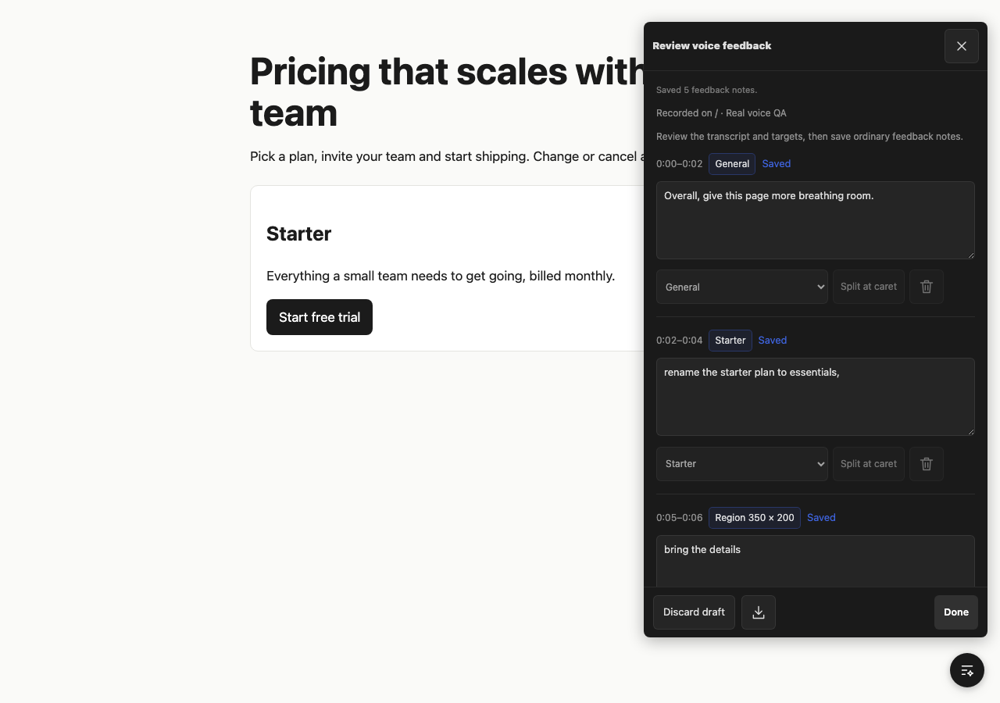
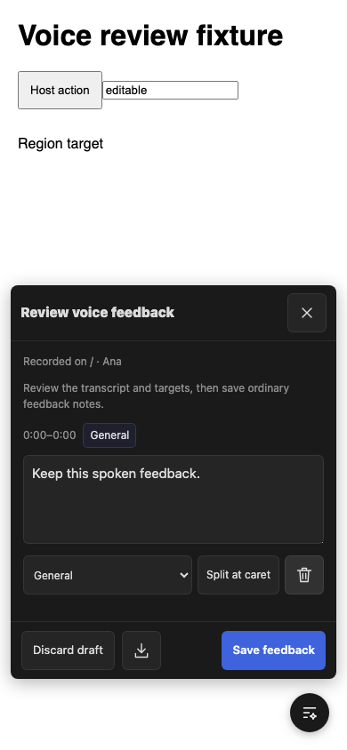

# Voice feedback

Two ways to speak feedback:

- **Dictate a note:** open a normal comment or reply, tap its microphone, start, speak and stop. Review the inserted text and save the note normally.
- **Talk and point:** open **More → microphone**, start recording and speak. Feedback starts in General. In **Point**, click an element or drag a region to anchor the next words. **General** or **Esc** returns to page-level feedback. **Interact** uses the page without choosing targets.

After Stop, review the transcript. Edit each passage, choose its target, split at the caret or remove it. Save feedback creates ordinary notes for the existing agent CLI/MCP loop. A JSON manifest is also downloadable. Audio is used for transcription and is not attached to saved notes.

## Run locally

Node 22.5+, pnpm and a browser with microphone recording are required. The toolbar bundle is checked in; building it requires the existing development dependencies.

```bash
pnpm install
pnpm build
pnpm prototype
```

Open `http://127.0.0.1:8877`.

## Transcription is built in

There is nothing to configure. `serve`, the framework plugins, `share` and the demo look after a local speech model themselves ([`server/voice-local.js`](server/voice-local.js)):

- The first time someone opens **Talk** or a note's microphone, the review server starts the bundled [faster-whisper](https://github.com/SYSTRAN/faster-whisper) bridge on `127.0.0.1:55945`. The panel says **Getting ready** and enables **Start recording** when the model answers. It never claims to be ready before that, and never invents a transcript.
- The first run on a machine takes a few minutes: it builds a Python environment in `~/.show-and-tell/voice-venv` and downloads the multilingual Whisper `base` model. After that it starts in seconds.
- Audio is transcribed on your computer. Nothing leaves it, and only the text is attached to a note.
- A bridge already answering on the port is reused and left running. One the review server started stops with it.
- It needs macOS or Linux and Python 3.10 to 3.13 (or `uv`). Where it can't run, the panel says why and offers **Type a note instead**.

| Variable | What it does |
|---|---|
| `SHOW_AND_TELL_VOICE=off` | Turn the built-in model off. |
| `SHOW_AND_TELL_VOICE_PORT` | Move the bridge off port 55945. |
| `SHOW_AND_TELL_TRANSCRIBE_URL` | Use your own OpenAI-compatible `/v1/audio/transcriptions` service instead (`_KEY` and `_MODEL` go with it). A remote one must be HTTPS. |

To warm it up ahead of a round, or to run the bridge by hand: `bash skill/show-and-tell/scripts/voice-server.sh` (it prints `READY <url>`).

Prototype notes are stored in `.prototype-data/`, which is ignored by Git. Set `SHOW_AND_TELL_STORE` to choose another directory. The default local transcription budget is 30 minutes per project per UTC day; `SHOW_AND_TELL_VOICE_DAILY_SECONDS` sets another limit. Failed requests reserve their used budget conservatively.

```bash
SHOW_AND_TELL_STORE="$PWD/.prototype-data" node bin/show-and-tell.mjs feedback show-and-tell-demo list --src example
```

## Region images

Region feedback works without a screenshot. Enable the image control to request a capture of the current browser tab. The prototype verifies the selected tab with the Capture Handle API and checks capture geometry before cropping. Unsupported browsers, denied access, another tab or mismatched geometry retain the region without attaching an image. Capture must not silently include a different screen.

Keep the page at its original zoom during capture. Tab capture APIs and permission prompts vary; real Safari/iPhone and screen-picker behavior require manual verification. The browser test suite exercises controlled capture tracks and rejection paths separately from real microphone/transcription tests.

## Hosted adapter (Cloudflare Workers)

`integrations/sharekit-voice.js` exports a Worker-compatible handler and an atomic D1 budget helper for serving transcription behind a hosted review link. It is integration code; nothing in this repo deploys it.

Mount it at `/p/<token>/__ag/voice/*` behind your host's own checks (the link exists, has not expired, is unlocked, has feedback switched on). The adapter requires `authorize` and `reserveBudget` callbacks and repeats authorization on every request. Enable voice per link explicitly. Use one account-wide D1 budget scope across all links; reviewer names are labels, not authentication.

The adapter uses the Worker's `env.AI` binding and Cloudflare-hosted Whisper Turbo. Browser capabilities advertise PCM WAV; the client converts captured audio before upload so the server can verify actual duration instead of trusting a browser-supplied timer. No provider key is exposed to the client. The hosted budget reserves before inference, with no paid provider fallback.

Workers AI currently includes 10,000 neurons per day; Whisper Turbo uses 46.63 neurons per audio minute, or about 214 minutes if the entire allowance is available. Other account usage reduces that headroom. Set a conservative application cap on a paid account if you want no extra inference charges. Sources checked 2026-11-04: [Workers AI pricing](https://developers.cloudflare.com/workers-ai/platform/pricing/), [Whisper Turbo](https://developers.cloudflare.com/workers-ai/models/whisper-large-v3-turbo/).

The bundle reads its configuration from `window.__AGENTATION_KIT_AGENTATION__`, and also accepts the older `window.__SHAREKIT_AGENTATION__` global (including query-routed page context) so existing hosted pages keep working.

## Timing and recovery

Microphone audio and target changes share a recording clock. Word timestamps permit precise boundaries. Without reliable word timing, a sentence crossing a target change stays intact and is flagged for review. Edited passages keep stable IDs; splitting edited words marks timing approximate.

Editable transcript and target history are checkpointed in the browser. Unsent audio remains in the current tab for retry and cannot be recovered after a reload. Close/navigation/hidden-tab transitions stop the microphone. A full navigation ends capture; this prototype does not promise recording continuity across page loads.

Saving uses deterministic note IDs, so retries do not create duplicate notes. Existing CLI/MCP readers show target, speech interval, selector/region and alignment cautions; raw JSON includes bounded image context.

## What agents read

Each element anchor also records the element's accessible name, role, nearest heading and landmark. A dragged region records up to eight elements it contains or crosses (tag, role, short name, selector, inside or partly), plus a count of the rest. Values are short, sanitised page text; screenshots stay optional.

Pointing cuts speech where the target changed, so a sentence can span several passages ("blue make" / "this a little bit larger"). CLI, MCP and Markdown readers therefore print the listed passages of one recording as whole sentences with inline markers, then a legend naming each target by its page content:

```
2. Let's change this free trial button to [→ T2 Start free trial] blue make [→ T3 Starter] this a little bit larger …
targets:
  T2 element "Start free trial" link · selector #trial-cta · under heading "Starter" · in main
```

The words after a marker were spoken while that target was selected. "(check timing)" marks a passage whose speech crossed a target change without word timing. Every word is kept; sentence text is capped at 6,000 characters with an explicit count of omitted sentences, and the per-passage notes always carry the full text. The downloaded manifest includes the same sentence view.

## Verify

```bash
pnpm test
# Optional Chromium tests:
pnpm add -D playwright
pnpm exec playwright install chromium
pnpm test:browser
# Real recording through a configured local speech service:
SHOW_AND_TELL_REAL_VOICE_TESTS=1 \
SHOW_AND_TELL_TRANSCRIBE_URL=http://127.0.0.1:55945/v1/audio/transcriptions \
node --test --no-warnings test/voice-real.test.mjs
```

The real speech test uses a synthetic English fixture as Chromium's microphone input and runs the actual recording, transcription, anchoring, editing and persistence path. It uses an isolated temporary store. The independent browser suite controls permission and screen streams to reproduce failures precisely.

See [independent QA](docs/voice/independent-qa.md) for results and bounded verification limits.




